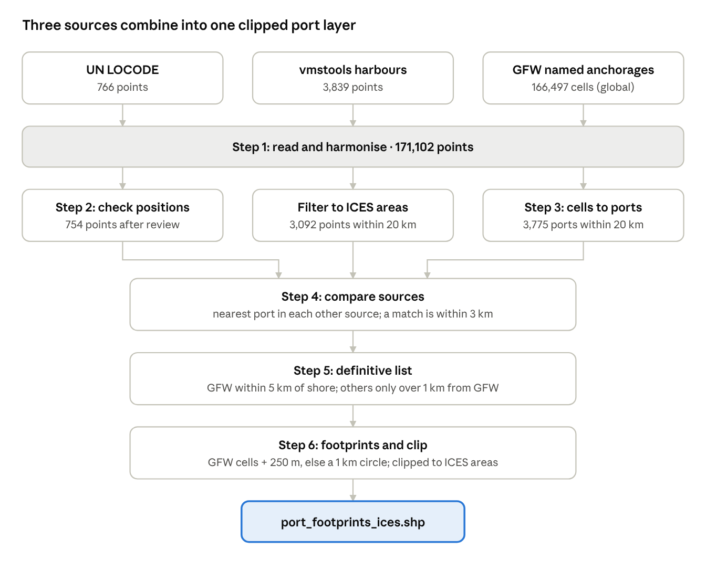
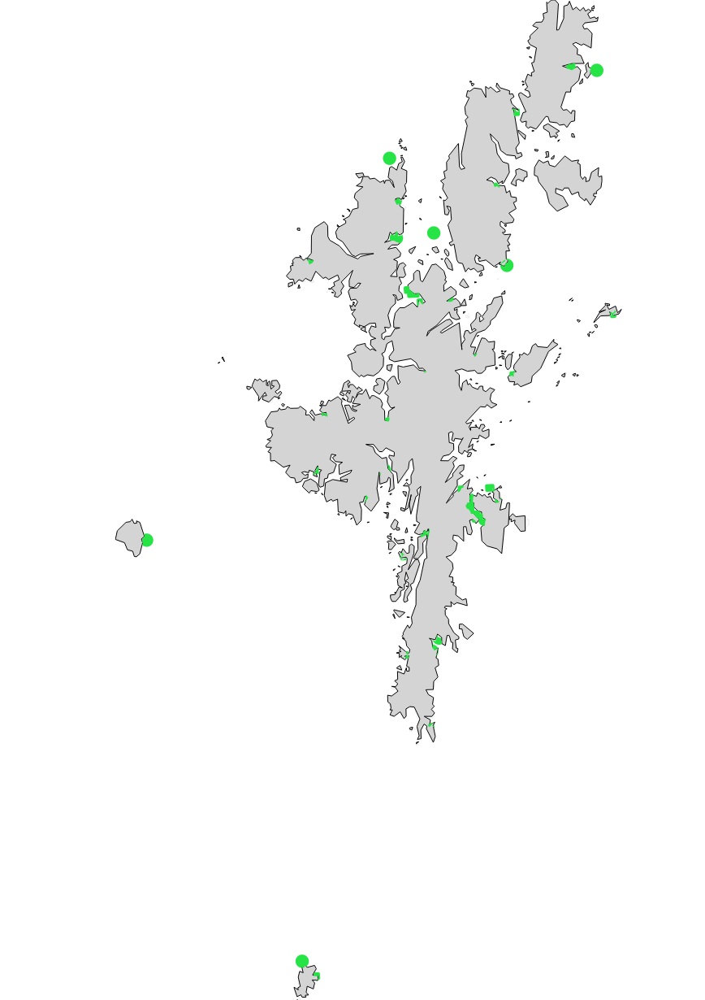

# A port footprint layer for the ICES VMS data call: methods

Neil Campbell · November 2026

**Download the latest port footprints:** [port_footprints_ices.zip](https://github.com/neilcampbelll/port_locations/releases/latest/download/port_footprints_ices.zip) (shapefile, WGS 84), rebuilt automatically from the [port_locations repository](https://github.com/neilcampbelll/port_locations) whenever the workflow or its data change.

## Summary

We built a single layer of port footprints for the ICES area by combining three port sources: the vmstools harbour list, UN LOCODE and Global Fishing Watch (GFW) named anchorages. GFW fills the largest gaps in the existing vmstools list, most clearly along the Norwegian coast, and also adds ports in Iceland and Portugal.

Where GFW has data, each port's footprint follows the anchorage cells GFW has mapped, plus a 250 m margin. Elsewhere, a 1 km circle replaces the 3 km circle used until now. All footprints are clipped to the ICES areas. In island groups like the Hebrides and Orkney, this greatly reduces the merging of neighbouring port buffers over fishing grounds.

The workflow is a single R script, `workflow.R`, in the [port_locations repository](https://github.com/neilcampbelll/port_locations). Every point-level correction is recorded in a review file.

## Background

The ICES VMS data call removes vessel positions reported in port. That stops moored vessels being counted as fishing effort. Until now this has used circles around the harbour positions in the vmstools R package, which come from an earlier EU project.

The vmstools list has two weaknesses:

- **Gaps:** coverage is thin or missing for several countries, notably Portugal, Iceland and Norway, so pings in those ports are not removed.
- **Merging buffers:** a fixed 3 km radius is too large where ports are close together, as in the Hebrides, Orkney and western Scotland. Neighbouring circles merge across sounds where fishing actually takes place, so real fishing pings are wrongly removed.

The UN LOCODE list is more comprehensive but brings its own problems:

- It includes non-ports, such as offshore oil fields and wind farms.
- It contains coordinate errors. Some points land in the Atlantic south-west of Ireland.
- Its positions are given only to the nearest minute.

The GFW named anchorages, derived from AIS, had not previously been assessed for this purpose.

## Data sources

Three port sources were combined, with two supporting layers for the spatial checks.

| Source | File | Records | What it holds | Known issues |
| --- | --- | --- | --- | --- |
| vmstools harbours | `data/vmstools_harbours.csv` | 3,839 | Harbour name, lon, lat, buffer range (3 for every row) | Latin-1 encoded; no country field; thin in Portugal, Iceland and Norway |
| UN LOCODE | `data/UN_LOCODE ports.csv` | 766 | Country (ISO 2), location code, name, centroid lon/lat | Positions to the nearest minute; non-ports and coordinate errors; 5 codes duplicated as Finnish/Swedish name pairs |
| GFW named anchorages | `data/named_anchorages_v2_pipe_v4_202609.csv` | 166,497 (global) | One row per S2 grid cell: label, country (ISO 3), lon, lat, at-dock flag, distance from shore, drift radius | Cell level, not port level; includes offshore installations and inland waterway berths |
| ICES areas | `ICESareas` in the vmstools package | – | ICES area polygons | Used to define the study area and clip the final footprints |
| Natural Earth 10m | Land and coastline layers, downloaded by the script | – | Global land polygons and coastline | Omits many small islands; used only to check UN LOCODE positions |

The UN LOCODE positions are the centroids of the port polygons in an earlier shapefile. All three sources' position fields are treated as WGS 84.

## Workflow overview

Each source is cleaned on its own track, then the three are compared and merged into one list, and every port becomes a footprint clipped to the ICES areas.

## Step 1: Read and harmonise the sources

The three files are read into one point layer, `ports_all` (171,102 points), with a common set of columns: `source`, `source_id`, `country`, `name`, `lon` and `lat`.

- **UN LOCODE:** `source_id` is the country code plus the location code (for example `GBCUN`).
- **vmstools:** the file is read as Latin-1, so names like Åbenrå display correctly. The unnamed first column duplicates the harbour name and is dropped. `country` is left empty.
- **GFW:** `source_id` is the S2 cell token, read as text so tokens made only of digits are not converted to numbers. Three-letter country codes are converted to two-letter codes with the `countrycode` package, to match UN LOCODE. The at-dock flag, distance from shore, drift radius and label source are kept for later steps.

The ICES vocabulary server was considered as an alternative to `countrycode`. Its country code list holds only two-letter codes, with no link to the three-letter codes GFW uses.

## Step 2: Check UN LOCODE positions

Of 766 UN LOCODE points, 58 were flagged as implausible and reviewed by hand. The review dropped 12 points and corrected 7, leaving 754.

**Automatic check.** Each point was tested against the Natural Earth 10m land and coastline layers, in the ETRS89-LAEA projection (EPSG:3035) so distances are in metres.

- **`at_sea`:** the point is in the sea and more than 5 km from the coast. 51 points.
- **`inland`:** the point is on land and more than 20 km from the coast. 7 points.

**Manual review.** Every flagged point, plus Wedlenstedt, was given a decision in `data/un_locode_review.csv`, with the reason recorded. The script applies the file and warns if a newly flagged point has no decision.

| Decision | Points | Examples and reasons |
| --- | --- | --- |
| Drop | 12 | Inland villages placed at sea by flipped or garbled longitudes (Billingborough, Bramshall, Elvillar, Mainzlar, Wedlenstedt); offshore installations (Argyll, Buchan and Curlew oil fields; Thorntonbank wind farm; Liverpool Bay Terminal; Bar Light); Covent Garden, placed off Cork |
| Fix | 7 | Longitude sign flipped (Cullen, Claonaig); wrong longitude digit (Gardabaer, Catterline, Withernsea); wrong latitude digit (Landeyjahöfn, Neeltje Jans) |
| Keep | 40 | Small-island ports missing from Natural Earth (e.g. Røst, Kvitsøy, Prangli, Clare Island); river and lake ports (e.g. Lauenburg, Boom, Marken); coastal ports with rough positions (e.g. Getxo, Cawsand) |

Wedlenstedt was not flagged. Its flipped longitude placed it on land on the Dingle peninsula, so it passed both checks and was added to the review by hand. All 7 `inland` points proved to be genuine river or lake ports.

## Step 3: Turn GFW anchorage cells into ports

GFW's 166,497 global cells were reduced to 3,775 ports near the ICES areas.

1. **Pre-filter.** Cells outside the ICES areas' bounding box, extended by 2°, are dropped. This only cuts the file down before the distance calculations.
2. **Group cells into ports.** Within each name and country, cells are linked by single-linkage clustering when within 5 km of each other. This keeps apart different places that share a name, which is common in Norway. Each port's position is the mean of its cells. Each port also records its number of cells, how many are flagged at dock, and the shortest distance from shore of any of its cells.
3. **Keep ports near the ICES areas.** Ports more than 20 km from the nearest ICES area polygon are dropped, which excludes the Mediterranean and west Greenland. Ports themselves lie on land or in harbours, outside the sea polygons, so a distance is used rather than an overlap. Ports 20 to 100 km away are written to `output/gfw_near_edge.csv` for checking.

GFW cells are level-14 S2 cells, roughly 0.5 km on a side. A cell becomes an anchorage once at least 20 different vessels have been stationary in it since 2012, where stationary means moving less than 0.5 km over at least 12 hours ([GFW anchorages](https://globalfishingwatch.org/datasets-and-code-anchorages/)). GFW's documentation suggests grouping cells into ports by label and country ([GFW technical documentation](https://globalfishingwatch.github.io/GFW_technical_documentation/files/anchorages-voyages-port-visits.html)). The 5 km split is added here to separate distinct places that share a name. Being regular tiles, the cells also serve as building blocks for the port shapes in step 6.

## Step 4: Compare the sources

Most unmatched ports are places only one source covers, not errors. The sources are largely complementary.

**Method.** vmstools and UN LOCODE were filtered to the same 20 km of the ICES areas as GFW. That left 3,092 vmstools points and all 754 UN LOCODE points. For each port, the script then found the nearest port in each of the other two sources, and its name and distance. Two ports within 3 km count as a match.

GFW ports are matched cell by cell, not by their mean position. A large port's mean can fall several km from any quay; Rotterdam's cells span tens of km. So:

- UN LOCODE and vmstools points are matched to the nearest GFW cell.
- GFW ports use the closest any of their cells comes to the other sources.

**Results.** Ports with no match in either other source, within 3 km:

| Source | Ports compared | Unmatched, by mean position | Unmatched, by cell |
| --- | --- | --- | --- |
| GFW | 3,775 | 2,261 | 2,164 |
| vmstools | 3,092 | 1,362 | 1,254 |
| UN LOCODE | 754 | 186 | 161 |

**What the unmatched ports are.**

- **GFW in Norway (816):** 773 lie more than 50 km from any vmstools port, so GFW fills the Norwegian gap. They are real fishing ports such as Andenes, Båtsfjord, Berlevåg and Ballstad.
- **GFW in the Netherlands (292):** mostly inland waterway towns, such as Aalsmeer, Gouda and Breda, picked up from barge AIS.
- **vmstools (1,254):** mostly in the UK and Ireland (about 450), Denmark and northern Germany (about 330), the Nordic countries (about 190) and France (about 170). Their median distance to a GFW cell is 8.2 km. Most look like small harbours with no AIS traffic.
- **UN LOCODE (161):** mostly Estonia (44), Norway (44) and the UK (36), with a median of 10.5 km to GFW. They are a mix of small ports and rough positions.

Names were carried along for checking but not used for matching. GFW names are upper case and spelt differently enough that name matching would need more cleaning.

## Step 5: Build the definitive port list

The definitive list keeps a GFW footprint wherever GFW has one, and falls back to the other sources only where it does not.

| Source | Kept when | Footprint in step 6 |
| --- | --- | --- |
| GFW | The port's nearest cell is no more than 5 km from shore | Cells plus margin |
| vmstools | More than 1 km from any GFW cell | Circle |
| UN LOCODE | More than 1 km from any GFW cell **and** more than 3 km from a vmstools point | Circle |

- **Offshore GFW ports.** A first map of the list showed GFW points scattered across the open North Sea and off Norway. These were oil and gas fields (Tyra, Gorm, Dan, Dumbarton), rigs (Rowan Stavanger) and unnamed offshore anchorages with labels like `GBR-537`, some more than 250 km from shore. None were flagged at dock. GFW's own distance from shore removes them, and unlike Natural Earth it does not miss small islands.
- **Points already covered by GFW.** A vmstools or UN LOCODE point within 1 km of a GFW cell is left out, because the GFW footprint already covers it.
- **Duplicate pairs.** Where a vmstools and a UN LOCODE point lie within 3 km of each other, the vmstools position is kept, because UN positions are only to the nearest minute.

## Step 6: Build footprints, clip and export

Each port in the definitive list becomes one polygon, clipped to the ICES areas and exported as a shapefile.

1. **GFW footprints.** Each cell's S2 token is converted back to its square polygon with the `s2` package. The script first checks that every token parses as a level-14 cell. A port's cells are merged and given a 250 m margin.
2. **Fallback circles.** vmstools and UN LOCODE ports get a 1 km circle, in place of the 3 km circle used until now.
3. **Clip to the ICES areas.** The footprints are intersected with the union of the ICES area polygons. Because those are sea polygons, each footprint is trimmed to its water part. Footprints entirely on land or outside the ICES areas disappear, including Gibraltar and Morocco. Stray lines or points left where a footprint only touches the boundary are discarded, and each port is regrouped to a single multipolygon.
4. **Export.** The result is written to `output/port_footprints_ices.shp` with `ENCODING=UTF-8`, so names such as Røst display correctly. Shapefile field names are limited to 10 characters, so only `source`, `source_id`, `country`, `name`, `lon`, `lat` and `footprint` are exported. `lon` and `lat` are the port point, which serves as a label position.

The settings were checked visually over the Hebrides, comparing the new footprints with 3 km circles around the vmstools points. The result was judged satisfactory on inspection; no area figures have yet been recorded.

## Parameters

All thresholds are set at the top of their step in `workflow.R`.

| Parameter | Value | Step | Effect |
| --- | --- | --- | --- |
| `max_sea_km` | 5 km | 2 | UN LOCODE points in the sea further than this from the coast are flagged |
| `max_inland_km` | 20 km | 2 | UN LOCODE points on land further than this from the coast are flagged |
| `cluster_km` | 5 km | 3 | GFW cells sharing a name and country, and this close together, form one port |
| `max_ices_km` | 20 km | 3, 4 | Ports further than this from an ICES area are dropped |
| `match_km` | 3 km | 4 | Ports in different sources this close together count as a match |
| `max_offshore_km` | 5 km | 5 | GFW ports whose nearest cell is further than this from shore are dropped |
| `gfw_cover_km` | 1 km | 5 | vmstools and UN LOCODE points this close to a GFW cell are left out as already covered |
| `dup_km` | 3 km | 5 | UN LOCODE points this close to a vmstools point are dropped as duplicates |
| `cell_margin_m` | 250 m | 6 | Margin added around each GFW port's cells |
| `circle_km` | 1 km | 6 | Radius of the fallback circle for ports without GFW cells |

## Outputs

The final product is `output/port_footprints_ices.shp`, published as [port_footprints_ices.zip](https://github.com/neilcampbelll/port_locations/releases/latest/download/port_footprints_ices.zip). Every file in `output/` can be rebuilt by running `workflow.R`.

| File | Step | Contents |
| --- | --- | --- |
| `output/port_footprints_ices.shp` | 6 | Final footprints clipped to the ICES areas, for sharing |
| `output/port_footprints.gpkg` | 6 | Footprints before clipping |
| `output/ports_final.gpkg`, `.csv` | 5 | Definitive port list with all nearest-neighbour columns |
| `output/ports_compared.gpkg` | 4 | All ports from the three sources, with match distances |
| `output/ports_unmatched.csv` | 4 | Ports with no match in another source |
| `output/gfw_ports_ices.gpkg` | 3 | GFW ports near the ICES areas |
| `output/gfw_near_edge.csv` | 3 | GFW ports 20 to 100 km from the ICES areas, for checking |
| `output/un_locode_clean.gpkg` | 2 | UN LOCODE after the manual review (754 points) |
| `output/un_locode_checked.gpkg` | 2 | UN LOCODE with the automatic flags |
| `output/un_locode_flagged.csv` | 2 | The 58 flagged points |
| `output/ports_all.gpkg` | 1 | All three sources harmonised (171,102 points) |
| `data/un_locode_review.csv` | 2 | Manual decisions: keep, drop or fix, with reasons (input, under version control) |

### Example: Shetland

*Port footprints in `port_footprints_ices.shp` around the Shetland Islands.*

## Limitations and further work

- **AIS coverage of small boats.** GFW cells come from AIS, which many smaller vessels do not carry, and a cell needs at least 20 stationary vessels to count as an anchorage. Small harbours can therefore have a tiny GFW footprint or none. Those ports rely on the 1 km fallback circle.
- **Thresholds not yet quantified.** The 250 m margin and 1 km circle were judged visually over the Hebrides. Testing them against VMS pings, by counting slow pings left just outside port footprints and fishing pings removed, would put numbers on the trade-off.
- **Position precision.** UN LOCODE positions are to the nearest minute. Points kept with notes such as "resolve in step 4" (e.g. Getxo, Solovki) have not been corrected individually, and may only be covered by a fallback circle placed some way from the quay.
- **Manual review from local knowledge.** The drop and fix decisions rest on knowledge of the named places. They are recorded with reasons so they can be challenged.
- **No country-containment check.** A sign error that moves a point onto land elsewhere, as with Wedlenstedt, passes the coastline checks. Testing that each point lies within its stated country would catch these.
- **No country for vmstools ports.** vmstools has no country field and none is assigned, so these ports have an empty country in the final layer. A nearest-port or country-polygon lookup could add one.
- **Inland waterway ports.** GFW includes many Dutch barge towns. They do no harm to VMS filtering but inflate the port count.
- **Anchorage-only clusters.** GFW ports with no at-dock cells, such as waiting anchorages close to shore, are kept. A rule keeping only ports with at least one at-dock cell could be tested.
- **GFW drift radius.** Each cell has a drift radius that could size its margin individually. Its units need confirming from GFW's documentation before use.
- **Name matching.** Matching is by distance only. Normalised names could help resolve rough UN LOCODE positions.

## Software and reproducibility

The full workflow is `workflow.R` in the [port_locations repository](https://github.com/neilcampbelll/port_locations). Run from the project root, it rebuilds every output from the files in `data/`. A GitHub Action reruns it whenever `workflow.R` or anything in `data/` changes, and publishes the shapefile as the latest release.

- **R packages:** `readr`, `dplyr` (including its `%>%` pipe), `sf`, `s2` (installed with `sf`), `countrycode` and `vmstools` (for `ICESareas`).
- **Natural Earth:** the 10m land and coastline layers are downloaded on first run to `data/natural_earth/`, which is excluded from the repository by `.gitignore`.
- **Projection:** distances and buffers are computed in ETRS89-LAEA (EPSG:3035). Outputs are in WGS 84 (EPSG:4326).
- **Manual decisions:** `data/un_locode_review.csv` is the only hand-edited input. Changing a decision and rerunning the script updates every output.

### Sources

- [vmstools R package](https://nielshintzen.github.io/vmstools)
- [GFW: Anchorages, ports and voyages](https://globalfishingwatch.org/datasets-and-code-anchorages/)
- [GFW technical documentation: anchorages, voyages and port visits](https://globalfishingwatch.github.io/GFW_technical_documentation/files/anchorages-voyages-port-visits.html)
- [UN/LOCODE](https://interoperable-europe.ec.europa.eu/collection/uncefact/solution/unlocode-codes-ports-and-other-locations)
- [Natural Earth 10m physical vectors](https://www.naturalearthdata.com/downloads/10m-physical-vectors/)
- [s2 package: S2 cells](https://r-spatial.github.io/s2/reference/s2_cell.html)
